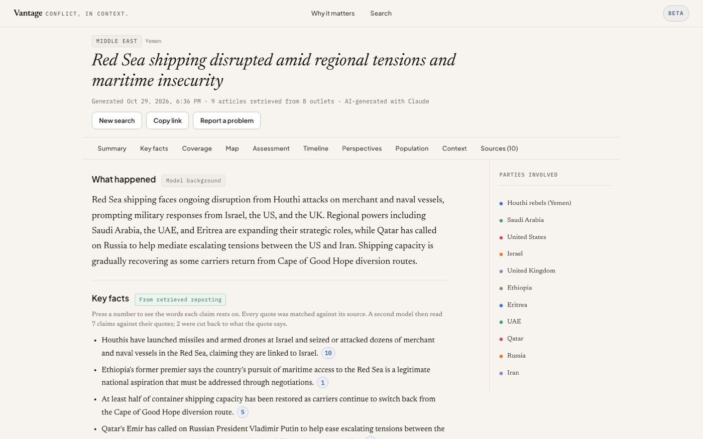
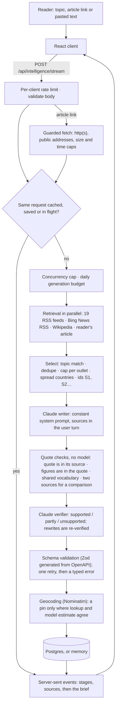

# Vantage

**Vantage turns a conflict topic or a news article into a structured brief whose key facts quote the retrieved reporting they rest on, and labels everything else as the model's background knowledge.**

Built by Nicole Rodriguez · [Portfolio](https://nicolerodriguez.dev) · [GitHub](https://github.com/Nicolercc)

[**Live demo**](https://conflict-analysis-vantage.vercel.app) · [](https://github.com/Nicolercc/vantage/actions/workflows/ci.yml)



## The problem

Following an international conflict means piecing together breaking-news reports, casualty figures, maps, history and competing political narratives, from outlets in different countries. A language model can summarise all of that fluently, but fluency hides which statements came from reporting and which the model supplied itself.

Vantage keeps that line visible. A reader enters a topic ("Sudan", "Red Sea shipping"), an article link, or pasted article text (up to 8,000 characters). The brief separates two kinds of content:

* **From retrieved reporting:** key facts and a cross-outlet comparison. Each claim quotes the words in the sources it cites; the quotes are checked against the retrieved text before the claim is shown.
* **Model background, labelled as such:** summary, parties, perspectives, timeline, historical context, escalation assessment, affected population and the map. The headline is model-written too; the page header marks every brief as AI-generated.

## How it works



The code lives in `artifacts/api-server/src/brief` (retrieval, prompt, generation, checks), `artifacts/api-server/src/lib` (storage, limits, config) and `artifacts/vantage` (React client). Details: [docs/architecture.md](docs/architecture.md). Configuration, readiness, cost tracking and deployment: [docs/operations.md](docs/operations.md).

## Key engineering decisions

**1. Provenance belongs to code, not the model.** The model refers to sources only by id (`S1`, `S2`…). Publisher, URL, date and country come from the retrieval layer, and any source metadata the model writes is overwritten.
*Tradeoff:* the brief can cite only what retrieval found, so a quiet conflict gets a thinner sourced section rather than a fuller, unverifiable one.

**2. Two checks before a claim is shown.** First, deterministic quote checks: the quote must occur in the cited source, every figure in the claim must occur in its quotes, and a comparison needs quotes from two sources. Then a second model judges whether the quotes support the claim. It can cut an overreaching claim back to what the quotes say, but the rewrite must pass the quote checks *and* a second verdict before it is labelled verified.
*Tradeoff:* one or two extra model calls per brief. "Verified" is still a model's judgment: on a hand-labelled set the quote checks alone stop 8 of 11 unsupported claims.

**3. The OpenAPI spec is the contract.** `lib/api-spec/openapi.yaml` generates the Zod schemas and the React Query client. The server validates requests and the model's brief against the same schemas, and CI fails if generated code drifts.
*Tradeoff:* a codegen step, and generated code is committed.

**4. Degrade instead of failing.** If the verifier is unreachable or answers unusably, claims are served marked "unverified". If the database fails, rate limits and the budget continue in-process from the last counts seen. If geocoding misses its deadline, the place is left off the map. A failed retrieval provider is reported, not fatal.
*Tradeoff:* during a database outage each instance enforces limits separately, so several instances together can exceed the global budget.

**5. Postgres is optional.** With `DATABASE_URL`, saved briefs, limits and the cost ledger survive restarts and are shared by instances. Without it everything lives in the process, and `/api/readyz` reports `durable: false`.
*Tradeoff:* a deployment without a database loses brief links on every restart.

## Testing and quality

Measured on this branch (Node 22, pnpm 9.9.0):

| Suite | Tests |
|---|---:|
| API: unit, route and contract tests (Vitest + Supertest, fake model and retrieval) | 210 |
| API: Postgres-backed store, limit, ledger and deadline tests (run when `TEST_DATABASE_URL` is set; CI sets it) | 12 |
| Client: input validation, streaming, brief adapter, map, labelling, dev proxy and stylesheet tests | 34 |
| **Total** | **256** |

* Route tests run the real Express app with a fake model and fake retrieval: no network, no API key, no spend.
* Fixture tests cover the guarantees directly: quotes that are not in their source, invented figures, unsupported verifier rewrites, malformed verifier output, prompt-injection text kept out of the system prompt, SSRF targets, geocoder disagreement and deadlines.
* CI (`.github/workflows/ci.yml`) runs a frozen-lockfile install, a codegen drift check, lint, typecheck, build and all tests against Postgres 16.
* `artifacts/api-server/eval` replays 16 recorded topics through the production generation path and grades them with a stronger model. Historical results are in [eval/REPORT.md](artifacts/api-server/eval/REPORT.md). A full run needs an API key; the workflow skips without one.

```bash
pnpm lint && pnpm typecheck && pnpm test && pnpm build
```

## Running locally

Requirements: Node.js 22+, pnpm 9.9.0, an Anthropic API key. Postgres is optional.

```bash
git clone https://github.com/Nicolercc/vantage.git
cd vantage
pnpm install
cp .env.example .env    # then set PORT=3001 and ANTHROPIC_API_KEY in .env
pnpm dev:api            # API on http://localhost:3001
pnpm dev                # client on http://localhost:5173 (proxies /api to the local API)
```

[`.env.example`](.env.example) lists every variable with a description. The API reads `.env` from the repository root (or from `artifacts/api-server`) and refuses to start, naming every malformed value, if its configuration is invalid. To run the client against a different API, start it with `VITE_API_PROXY_TARGET=<url> pnpm dev`.

## Limitations

* **Headlines and summaries, not full articles.** RSS feeds and the news search supply a headline and a short summary, so claims are checked against that text. A reader-supplied article is read in full up to 8,000 characters; a fetched page is cut to its first 8,000.
* **Retrieval has no service agreement.** The news search is Bing's public RSS feed, and publisher feeds hold only recent items. The brief reports how many providers were checked and how many returned something.
* **"Verified" is a model's opinion** about words that provably occur in a source. In the latest recorded evaluation a stronger model judged 9 of 70 kept claims as only partly supported. The expected-fact lists used for grading are not yet approved by a person.
* **Prompt injection is mitigated, not proven against.** Retrieved text never enters the system prompt and cannot close its own source block, but no adversarial evaluation against a live model has been run.
* **Long worst case.** Each model call, fetch and database statement has its own deadline, and the whole brief is capped at the sum of its steps' limits (about 4.3 minutes with the defaults; then everything in flight is aborted and the reader gets `TIMED_OUT`). Fetching a linked article happens before that cap.
* **Per-process pieces.** The concurrency cap and in-flight deduplication are per process.
* **Observability gaps.** Errors carry a request id in the JSON body and the `X-Request-Id` header, but the UI does not show it yet. `/api/ops/costs` counts successful writer calls, so a retried brief counts twice.
* **Saved briefs last 30 days.** After that a brief's link answers 404 and the row is deleted; there is no route to delete one sooner. Saved briefs never contain the reader's pasted text, though the model's summary may paraphrase it.

## License

[MIT](LICENSE) © Nicole Rodriguez
